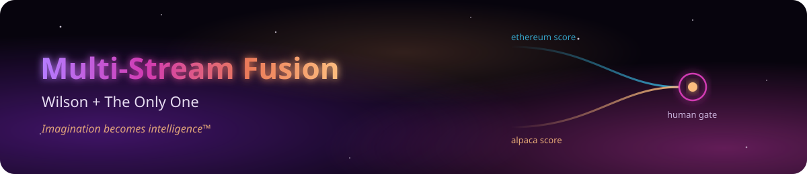
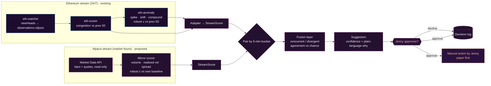

<p align="center">
  
</p>

# Multi-Stream Fusion — Architecture

> **Status:** design document. Only the Ethereum scorer/anomaly logger exists today. Everything else here is **proposed** and has no code in this repo yet. Nothing in this design places trades.
> **Owner / Architect:** Jennifer Cox (Jenny) · **Last updated:** 2026-10-27

## 1. Overview

Wilson watches two very different streams: the Ethereum chain (24/7, one block about every 12 s) and US equities through Alpaca (market hours only). Instead of comparing prices or timestamps across those two worlds, each stream gets its **own independent scorer** that answers one question: *"How unusual is this, compared with its own recent normal?"* A **fusion layer** then compares the two *score streams* and notices when they line up (both unusual at once) or split apart (one very unusual, the other unusually calm). Every fused signal becomes a **suggestion for Jenny**. It never becomes an order.

### Status

| Component | Status | Where it lives |
|---|---|---|
| Ethereum block watcher (`newHeads` → NDJSON) | **Existing**, running under pm2 as `eth-watcher` | Grok Bot box: `eth-watcher/watcher.js` (outside this repo) |
| Ethereum block scorer (congestion score vs previous 50 blocks) | **Existing**, pm2 `eth-scorer` | box: `eth-watcher/scorer/model.cjs`, `streamScorer.cjs` |
| Ethereum anomaly logger (spike / shift / compound vs previous 50 blocks) | **Existing**, pm2 `eth-anomaly` | box: `eth-watcher/anomaly/model.cjs`, `streamAnomaly.cjs` |
| Silver Harbor on the Windows PC (connector, 1 h evaluator, dispatcher) | **Existing**, a separate rule set | `silverharbor/README.md`; scripts live on the PC |
| Ethereum → `StreamScore` adapter (per time bucket) | **Proposed** | — |
| Alpaca mirror scorer | **Proposed** | — |
| Fusion layer | **Proposed** | — |
| Human gate (suggestions + approval log) | **Proposed** | — |

**Alpaca account:** live, real money, **$0 balance**. Trading is manual today. This design adds no order path. Paper testing comes before any live use (see §5).

> Note: `trading/` already contains a separate, older portfolio manager with a `TRADE_MODE=auto` option. The fusion system **must not** import from it or call it. Its only output is a suggestion (see §5).

## 2. Two independent scorers, one per stream

Each scorer only knows its own stream. Neither scorer reads the other one's data. Both output the same `StreamScore` shape, so the fusion layer can compare them without knowing where a score came from.

### 2.1 Shared contract (proposed)

Types follow the conventions in `src/intelligence/` and `src/core/wilson/WilsonTypes.ts`: vendor-neutral, PascalCase file per contract, types-only first, `import type` across files. Proposed home: `src/intelligence/fusion/` (`StreamScore.ts`, `FusedSignal.ts`, `Suggestion.ts`). These files **are not created yet**.

```ts
/**
 * StreamScore — one scorer's verdict for one key over one time window.
 * Proposal: types only. No vendor-specific assumptions.
 */
export type StreamId = "ethereum" | "alpaca";

/** quiet = unusually calm; normal; elevated = |z| >= 2.5; hard = |z| >= 4 */
export type StreamFlag = "quiet" | "normal" | "elevated" | "hard";

export interface StreamScore {
  stream: StreamId;
  key: string;              // "mainnet" for Ethereum, ticker symbol for Alpaca (e.g. "SPY")
  windowStart: string;      // ISO-8601, inclusive
  windowEnd: string;        // ISO-8601, exclusive
  score: number;            // max |robust z| across features, in "spread units" (>= 0)
  direction: "up" | "down" | "mixed"; // busier/higher vs quieter/lower than normal
  flag: StreamFlag;
  features: Record<string, number>;   // per-feature robust z, e.g. { baseFee: 4.3, fullness: 1.1 }
  baselineN: number;        // observations in the baseline the z-scores were measured against
}
```

**One shared scale.** Both scorers use the same robust z: `(value − median) / max(1.4826 × MAD, floor)`, which is exactly what the existing anomaly logger uses. So `score = 4` means the same thing on both sides: four robust spreads away from that stream's own normal. Flag cut-offs reuse the logger's existing thresholds:

| Flag | Rule |
|---|---|
| `hard` | score ≥ 4 (the logger's spike threshold `Z_SPIKE`) |
| `elevated` | score ≥ 2.5 (the logger's compound threshold `Z_COMPOUND`) |
| `quiet` | score < 0.5 **and** the stream's activity measure is in the bottom 20% of its baseline |
| `normal` | everything else |

### 2.2 Ethereum scorer (existing logic, plus a proposed adapter)

What runs today, from the code:

- **`eth-scorer`** (`scorer/model.cjs`): for each block, scores **utilization** (gasUsed / gasLimit), **fee ratio** (base fee / rolling median, in log space) and **block interval** (vs the 12 s slot) against the **previous 50 blocks**. Each z is squashed with `tanh(z/2)`, weighted 1.0 / 1.0 / 0.5 and passed through a sigmoid. That gives a congestion score where 0.5 = typical, higher = busier. It warms up for 10 blocks, has std floors to avoid zero-variance lock, and writes `data/scores.ndjson`.
- **`eth-anomaly`** (`anomaly/model.cjs`): reads those receipts and, using **robust z vs the previous 50 blocks** on base fee (log space), gap, fullness and the congestion score, writes notes to `data/anomalies.ndjson`:
  - **spike:** one block with |z| ≥ 4, plus a materiality rule (fee ≥ 1.25× or ≤ 0.8×, gap ≥ 36 s, fullness ±40 pts, score ±0.30). There is a 10-block cooldown per metric.
  - **shift:** the median of the last 10 blocks vs the 50 blocks before them, with |z| ≥ 3 plus materiality. It is latched, so it logs once per episode.
  - **compound:** two or more independent metrics each with |z| ≥ 2.5, all in the same direction, and root-sum-square z ≥ 4.
  - Severity is high, medium or low, based on max |z| and how many metrics are off. Everything is watch-only, with no network calls and no alerts.
  - As of 2026-10-27 its state file shows 47 notes across 1,641 judged blocks (29 spike, 14 shift, 4 compound).

**Proposed adapter (`eth → StreamScore`):** for each fusion bucket (§3), take the blocks in that bucket, and for each metric take the block with the largest |robust z|. Then `score = max |z|`, `features = { baseFee, gap, fullness }` z-values, and `baselineN = 50`. If an anomaly note of kind `spike` landed in the bucket, the flag is `hard`. A `compound` or `shift` note makes it at least `elevated`. The adapter only reads `scores.ndjson` and `anomalies.ndjson`. It does not change either process.

### 2.3 Alpaca mirror scorer (proposed)

This is a mirror of the Ethereum logger for stocks. It compares each symbol with **its own recent norm**, never with other stocks.

| Feature | Per bucket (e.g. 5-min bars) | Stat space |
|---|---|---|
| `volume` | bar volume vs the same time of day over the baseline | log volume (volume has an intraday U-shape, so it is compared by time of day) |
| `volatility` | realized vol = std of 1-min log returns inside the bucket | log realized vol |
| `spread` | median relative bid-ask spread `(ask − bid) / mid` from quotes | log spread |

- **Baseline:** a per-symbol rolling window of the previous **N = 50 regular-session buckets** (matching the 50-block Ethereum window), with volume taken from the matching time-of-day slot across the last 20 sessions. It warms up before scoring and uses floors on the MAD, the same way the Ethereum logger does.
- **Score:** `score = max |robust z|` over the three features. Direction is "up" when most features are higher than normal. `quiet` means all |z| < 0.5 and volume is in the bottom 20% for that time of day.
- **Data source:** the Alpaca Market Data API (bars and quotes), read-only. On the free plan the feed is IEX only, which is a slice of total US volume, and its quotes are not the full NBBO. So spreads and volume are *relative* measures, compared with the symbol's own IEX history. They are not market-wide truth.
- **Hours:** regular session only (9:30–16:00 ET). Outside those hours the Alpaca scorer emits nothing, so there is nothing to fuse.
- **No keys in the repo.** Keys stay in a gitignored env file on the machine that runs the scorer. The scorer needs a data-only key and must never call order endpoints.

## 3. Fusion layer (proposed)

The fusion layer compares **scores, not prices or timestamps.** Time is used only to *pair* scores: both streams are cut into the same coarse buckets (default 5 minutes, aligned to the clock in UTC), and the two `StreamScore`s for a bucket are compared. Nothing is matched block-by-trade.

### 3.1 When it fires

| Pattern | Rule |
|---|---|
| `concurrent` | both scores are `elevated` or `hard` in the same bucket |
| `divergent` | one score is `hard` **and** the other is `quiet` in the same bucket |

Anything else is recorded as a non-event, but it still counts toward the base rates below.

### 3.2 Agreement tracking

For every bucket where both streams have a score (market hours only), the fusion layer keeps rolling counts over a window (e.g. the last 20 sessions):

- `nBuckets`: paired buckets seen
- `pEth`, `pAlp`: how often each stream is elevated or hard on its own
- `expectedConcurrent = pEth × pAlp × nBuckets`: how many concurrent flags **pure coincidence** would produce if the streams were unrelated
- `observedConcurrent`, `observedDivergent`, and their ratio to chance (**lift**)
- per-symbol counts, so one noisy stock doesn't dominate

These counts are shown with every signal, so coincidence is always visible next to the claim.

```ts
export type FusionPattern = "concurrent" | "divergent";

export interface AgreementHistory {
  windowSessions: number;       // e.g. 20
  nBuckets: number;             // paired buckets in the window
  pEthFlag: number;             // share of buckets where Ethereum was elevated/hard
  pAlpacaFlag: number;          // same for this Alpaca key
  observed: Record<FusionPattern, number>;
  expectedByChance: Record<FusionPattern, number>;
  lift: Record<FusionPattern, number>; // observed / expected (1 = no better than coincidence)
}

export interface FusedSignal {
  id: string;
  bucket: { start: string; end: string };
  pattern: FusionPattern;
  ethereum: StreamScore;
  alpaca: StreamScore;
  confidence: number;           // 0–1, see below
  agreementHistory: AgreementHistory;
  createdAt: string;
}
```

### 3.3 Confidence: kept deliberately simple

```
strength   = concurrent: min(1, min(scoreEth, scoreAlp) / 6)
             divergent:  min(1, scoreHard / 6)
edge       = clamp((lift − 1) / lift, 0, 1)      // 0 when the pattern is no more common than chance
sampleSize = n / (n + 30)                       // n = past occurrences of this pattern; small n pulls confidence down
confidence = round(strength × edge × sampleSize, 2), capped at 0.9
```

A strong signal in a pattern that historically happens no more often than chance gets confidence close to 0. That is intentional. Confidence describes *how unusual and how historically non-random* the pattern is. It is **not** a probability of profit.

## 4. Flow



## 5. Human gate: hard rule

> **Nothing trades without Jennifer's explicit approval. There is no autonomous execution path.**

- Every `FusedSignal` becomes a `Suggestion`. The fusion system has **no** broker client, **no** order endpoint and **no** trading keys. It cannot place an order even by mistake.
- Each suggestion shows the pattern, both scores with their top features, the confidence, the agreement history and how it compares with chance, and a plain-language explanation of why it fired. Like the existing scorer's `why` field, it is written for a person, not for a machine.
- Jenny approves or declines each suggestion. Both answers are logged with a timestamp and an optional note. Approval does **not** place an order. It only records her decision, and any action is taken by hand by Jenny.
- Silence is a decline. Suggestions expire at the end of their bucket's session.
- **Paper first:** approved suggestions are tracked against a paper account or a simple paper ledger for an agreed trial period before Jenny considers any live use. The live Alpaca account currently holds $0.
- This is visible only to the Architect, with nothing exposed to other Wilson users.

```ts
export type SuggestionDecision = "pending" | "approved" | "declined" | "expired";

export interface Suggestion {
  id: string;
  signal: FusedSignal;
  confidence: number;          // copied from signal, 0–1
  rationale: string;           // plain language: what lined up, how often that happens by chance
  caveats: string[];           // always includes "correlation, not cause"
  decision: SuggestionDecision;
  decidedBy?: "jenny";         // the only possible approver
  decidedAt?: string;
  note?: string;
}
```

## 6. Honest caveats

- **Correlation, not cause.** Even a pattern that beats chance does not mean one stream drives the other. Both may be reacting to the same news, or the match may be luck.
- **Multiple comparisons.** Many symbols × many buckets × two patterns means some "significant" matches will show up by chance alone. The base rates and lift exist to make that visible. More symbols means more false positives.
- **Small samples.** Market hours give only about 78 five-minute buckets a day. Real confidence needs weeks of data, and the `n / (n + 30)` term keeps early confidence low on purpose.
- **Regime changes.** Fee markets, upgrades, holidays, earnings and volatility regimes shift what "normal" means. Rolling baselines adapt, but signals around those shifts are unreliable.
- **Different clocks.** Ethereum runs 24/7, while stocks trade about 6.5 h on weekdays. Fusion happens only when both are open, and overnight and weekend chain activity is not compared with anything.
- **Data limits.** The free IEX feed is a partial view of volume and quotes. Chain data depends on public RPC endpoints, which can drop out (as with the Windows PC's ISP filter in Oct 2026).
- **Not financial advice.** This is an observation and research tool for one person. It makes suggestions only, and every decision and its consequences are Jenny's.
